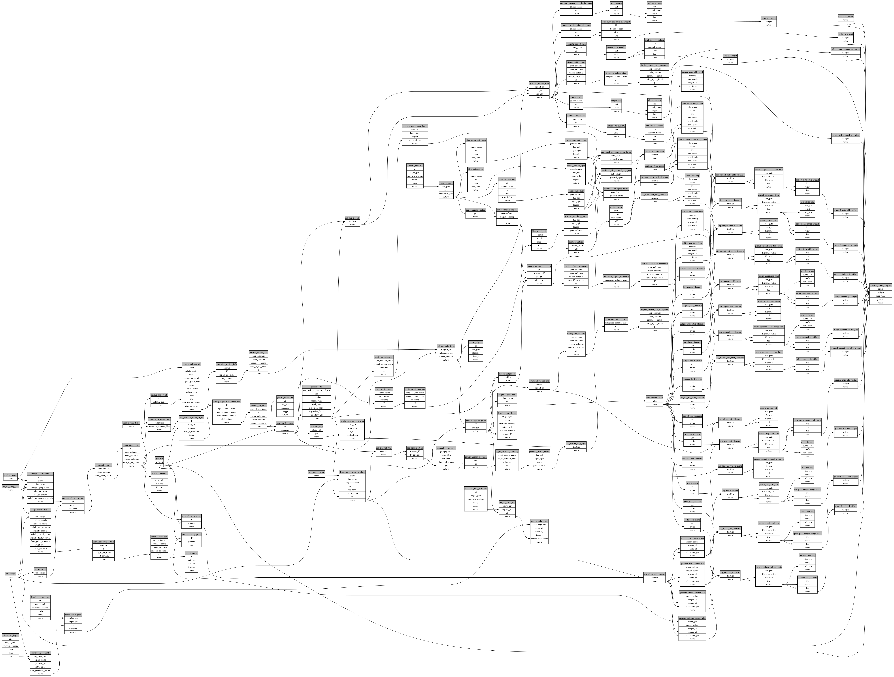

```
# AUTOGENERATED BY ECOSCOPE-WORKFLOWS; see fingerprint in README.md for details

```

```yaml
# fingerprint:
artifacts_sha256_basic: ea50404e9c678b74a24c1053a0d082cc45652cf82e9792be48f58bfd4be38b94
artifacts_sha256_strict: 3e3d3ee74c5355879b90edc99bdd04bdf906b9908cd590ed84a3ae9421626033
installed_requirements:
- channel: https://repo.prefix.dev/ecoscope-workflows/
  name: ecoscope-platform
  version: {version: ==2.15.1}
- channel: https://repo.prefix.dev/ecoscope-workflows-custom/
  name: ecoscope-workflows-ext-custom
  version: {version: ==0.1.0rc14}
- channel: https://repo.prefix.dev/ecoscope-workflows-custom/
  name: ecoscope-workflows-ext-ste
  version: {version: ==0.0.0rc1}
- channel: https://repo.prefix.dev/ecoscope-workflows-custom/
  name: ecoscope-workflows-ext-mep
  version: {version: ==1.0.0}
- channel: conda-forge
  name: pydeck
  version: {version: ==0.9.2}
- channel: conda-forge
  name: opentelemetry-sdk
  version: {version: ==1.44.0}
params_sha256: cc0bf1b8244dcf50c9cd2adc9f93b9c86ba4a13f0308d6dc7d3ecc2e3d219189
spec_sha256: a8a9adda153395565c52b68dd7733aa32914c30acf19b7a21472af203a28a8f1

```

# ecoscope-workflows-mep-collared-report-workflow


